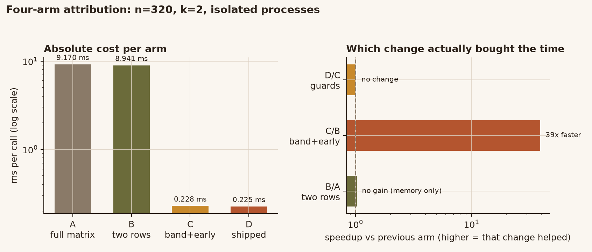
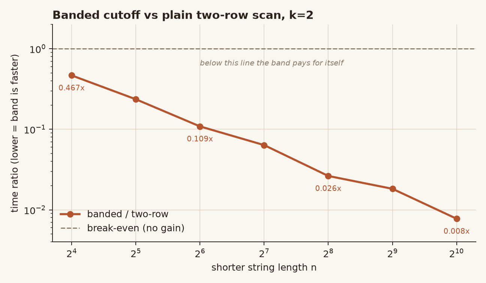
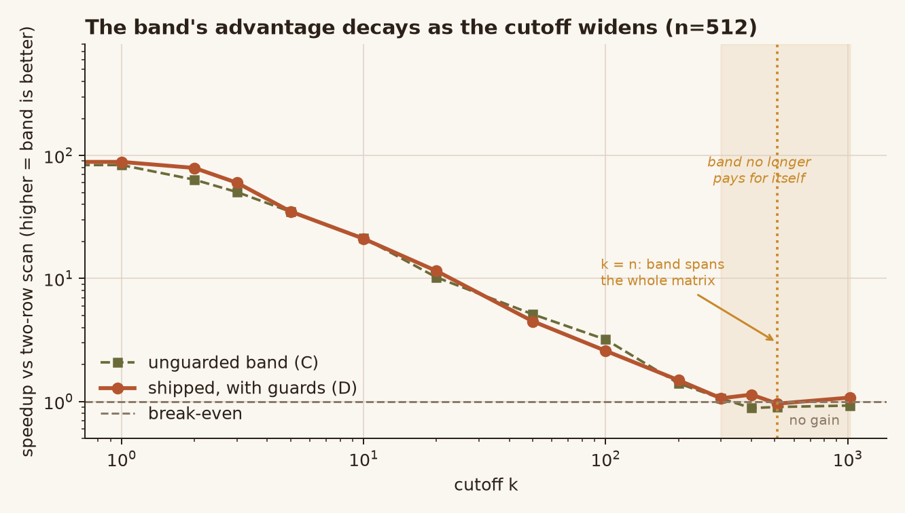
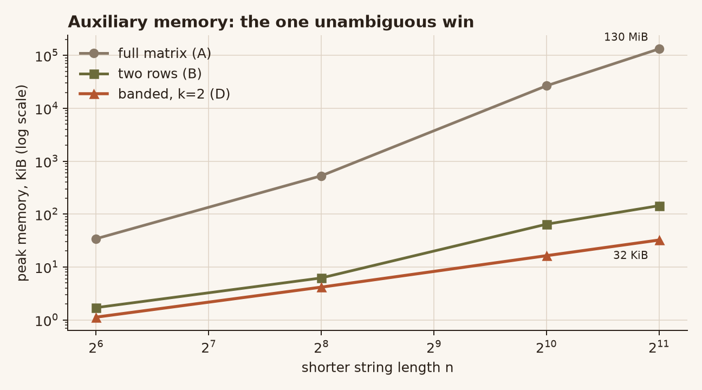

# levenshtein-band-lab

Banded Levenshtein distance with **measured** guards, and an honest four-arm
benchmark that shows which change actually bought the time.

Most "banded Levenshtein" write-ups report a single big speedup from an
"optimized vs original" comparison. That comparison usually hides three
separate changes at once. This repo splits them apart, measures each in
isolation, and then ships the version that is never slower than the simple
baseline.

```python
from levlab import distance_at_most, levenshtein_distance, within_distance

levenshtein_distance("kitten", "sitting")   # 3
distance_at_most("kitten", "sitting", 3)    # 3
distance_at_most("kitten", "sitting", 2)    # None (exceeds the cutoff)
within_distance("kitten", "sitting", 3)     # True
```

No third-party dependencies. Python 3.10+.

---

## The short version

| Question | Answer |
|---|---|
| Is the band faster on long strings? | Yes, by 39x at n=320/k=2, 125x at n=1024 |
| Is the band faster on 2-4 character Chinese terms? | **No — 1.1-1.4x slower** without a guard |
| Does the rolling two-row form save time? | **No.** It saves memory, not time (0.98x) |
| Is the cutoff cheap when k is huge? | **No** — band spans the matrix; needs a guard |
| What actually wins? | The band + early exit. Everything else is bookkeeping. |



The right-hand panel is the whole point. Two rows: no gain. Band + early exit:
39x. Guards: neutral here, but they prevent regressions elsewhere.

---

## Four arms, adjacent comparisons

The benchmark deliberately keeps four arms so every number is traceable to the
pair that isolates it.

| Arm | What it does | Purpose |
|---|---|---|
| **A** `full_matrix` | Full DP matrix, reallocated per call | The naive baseline |
| **B** `two_row_full` | Rolling two rows, all cells | Isolates the matrix allocation |
| **C** `band_core` | Band + row-min early exit, no guards | Isolates the band |
| **D** `levlab` | Shipped: band + both guards | Isolates the guards |

Measured with one interpreter per arm (`--isolated`), n=320, k=2:

| Case | A | B | C | D | B/A | C/B | D/C |
|---|---:|---:|---:|---:|---:|---:|---:|
| near-match | 9.170 ms | 8.941 ms | 0.228 ms | 0.225 ms | **0.98x** | **0.026x** | 0.99x |
| early-reject | 10.865 ms | 9.815 ms | 0.003 ms | 0.003 ms | 0.90x | 0.000x | 1.16x |
| length-gap | 10.333 ms | 10.091 ms | 0.240 ms | 0.000 ms | 0.98x | 0.024x | 0.00x |

Reading it:

- **B/A ≈ 0.98x.** Replacing the full matrix with two rolling rows changes
  nothing in time. It is a memory optimisation, full stop.
- **C/B ≈ 0.026x.** The band plus row-minimum early termination is where the
  entire ~39x lives.
- **D/C = 0.00x on length-gap.** That case never computes a single DP cell; it
  returns after one `abs()` comparison. Reporting it as a "banded speedup"
  would be wrong — anyone can add that `if` to the baseline and get the same
  number.

> An earlier draft of this project reported 3,726x and 44,447x for the last two
> cases. Those were ratios between two quantities both at the timer's noise
> floor. The honest statement is "below timing resolution", so that is what the
> report says now.

---

## The band's advantage is a function of n *and* k

A single benchmark point (n=320, k=2) sits squarely in the band's favourable
region and hides two regressions. Both are plotted and both are guarded.



At k=2 the band wins from n≈8 upward and the margin keeps growing:

| n | 16 | 32 | 64 | 128 | 256 | 512 | 1024 |
|---|---:|---:|---:|---:|---:|---:|---:|
| band / two-row | 0.467x | 0.236x | 0.109x | 0.064x | 0.026x | 0.018x | **0.008x** |



Widening the cutoff decays the advantage: ~80x at k=0-1, 10x at k=20, 1.5x at
k=100, and break-even by k≈300. Past `k = min(len(a), len(b))` the band spans
the entire matrix, so it is pure overhead.

### Measured crossover lengths

`benchmarks/crossover.py` interleaves the two kernels over 31 rounds per point
(≥30 ms per sample) and only declares a win when **median < 0.90 and p90 <
1.00**. The strict rule matters: an earlier pass with fewer rounds suggested
k=2 crossed at n=6; with 31 rounds the honest answer is n=8.

| cutoff k | band wins from | shipped `BAND_MIN_LENGTH` |
|---|---:|---:|
| 0 | n ≥ 3 | 3 |
| 1 | n ≥ 5 | 5 |
| 2 | n ≥ 8 | 8 |
| 3 | n ≥ 9 | 9 |
| ≥4 | grows ~2 chars per unit of k | extrapolated |

Below those lengths the band is slower, because each band cell costs 3-4x a
cell of the compact two-row inner loop (`lo`/`hi` arithmetic, two boundary
resets, `row_min` maintenance). On a 2-character string there are barely any
cells to save.

---

## The two guards

```python
shorter = min(len(a), len(b))

# Guard 1: length gap - insertions alone already blow the budget.
if abs(len(a) - len(b)) > max_distance:
    return None

# Guard 2: the band would span the whole matrix; drop the machinery.
# Guard 3: too short for the band to pay for its own bookkeeping.
if max_distance >= shorter or shorter < _band_min_length(max_distance):
    return _two_row_at_most(a, b, max_distance)
```

Guards are verified by **path assertions**, not by stopwatch. Short-string
timings are 1-20 µs, close enough to timer noise that a measured "win" can flip
sign between runs. `tests/test_dispatch.py` patches the internal kernels with
call counters and asserts *which path ran*:

```
len below crossover  -> two-row path (band not entered)
len at/above crossover -> band path
k >= min(len)        -> two-row path
```

That is deterministic, so the claim is checkable even when the timer is not.

---

## Memory: the unambiguous win



Peak auxiliary memory, `tracemalloc`, min-of-5:

| n | full matrix | two rows | banded k=2 |
|---:|---:|---:|---:|
| 64 | 34.2 KiB | 1.7 KiB | 1.1 KiB |
| 256 | 530.1 KiB | 6.2 KiB | 4.2 KiB |
| 1024 | 26.1 MiB | 64.4 KiB | 16.4 KiB |
| 2048 | **130.2 MiB** | 144.4 KiB | **32.4 KiB** |

`O(min(m, n))` as advertised. Note the band still allocates full-width row
buffers, so its space is `O(m)`, not the `O(k)` a textbook Ukkonen
implementation achieves — indexing within the band would cut it by another
order of magnitude. The claim in the docstring matches what the code does.

---

## When to use this

**Good fit**

- You have a fixed small cutoff (`k ≤ 5`) and strings longer than ~10 characters.
- Deduplicating near-identical records, spell-check against a dictionary,
  fuzzy join on titles or addresses.
- Memory matters: 130 MiB → 32 KiB at n=2048.

**Bad fit**

- Short search-box terms (2-4 Chinese characters). The guard will silently route
  you to the two-row scan, so you get no speedup — just use the plain scan.
- Huge cutoffs (`k` comparable to the string length). Same: guarded into the
  two-row path.
- You need exact distance for long strings with no cutoff. Use
  `levenshtein_distance`; the band does not apply.

---

## Semantics

- Case-sensitive.
- Python Unicode code points, not grapheme clusters. `"a\u0301"` and `"\u00e1"`
  are distance 2, not 0 — no canonical normalisation is performed.
- Insertion, deletion, substitution each cost 1. Transposition is **not** a
  single operation; that is Damerau-Levenshtein, a different metric.

---

## Run the tests

```bash
python -m unittest discover -s tests -t .        # full: ~2 min
LEVLAB_FAST=1 python -m unittest discover -s tests -t .   # CI: <1 s
```

25 tests. `LEVLAB_FAST=1` skips only the exhaustive sweep (every pair of
strings up to length 5 over a 4-character alphabet, ~1.86M pairs).

Coverage worth noting:

- Independent full-matrix oracle, written differently from the implementation so
  a shared bug cannot make both agree.
- Narrow-band path on long strings (`lo > 1` and `hi < m` active in one row) —
  the case the original short exhaustive sweep could never reach.
- `k > len` degeneration, `\u0301` combining marks, symmetry, triangle
  inequality.
- Path assertions for both guards.

## Run the benchmark

```bash
python benchmarks/run_all.py             # full sweep -> results.json
python benchmarks/run_all.py --quick     # smoke -> results-quick.json
python benchmarks/run_all.py --isolated  # one process per arm
python benchmarks/crossover.py           # high-repetition crossover measurement
```

`--quick` writes `results-quick.json` and never touches `results.json`, so a
smoke run cannot overwrite a real measurement table.

---

## Benchmark methodology

Five rules, each learned from a mistake in this project:

1. **Ratios, not milliseconds.** Absolute wall-clock drifted by 3x between cases
   inside one process (allocator state accumulates; a 320x320 matrix is ~100k
   objects per call). A ratio computed within a round cancels the drift.
2. **Interleave the arms.** Running A to completion then B lets CPU frequency
   and background load land entirely on one side.
3. **Adjacent pairs only.** "Optimized vs original" hides how many changes the
   optimized version made. Report the ratio for each neighbouring pair.
4. **`--isolated` for headline numbers.** One interpreter per arm removes
   cross-case contamination entirely.
5. **best-of-N for time, min-of-N for `tracemalloc`.** Interference only ever
   makes a run slower, so the minimum is the least contaminated sample.

Reproduce on your own machine before quoting any number here. The shape is
stable; the absolute crossover points move with interpreter version and CPU.

---

## License

MIT. See [LICENSE](LICENSE).
